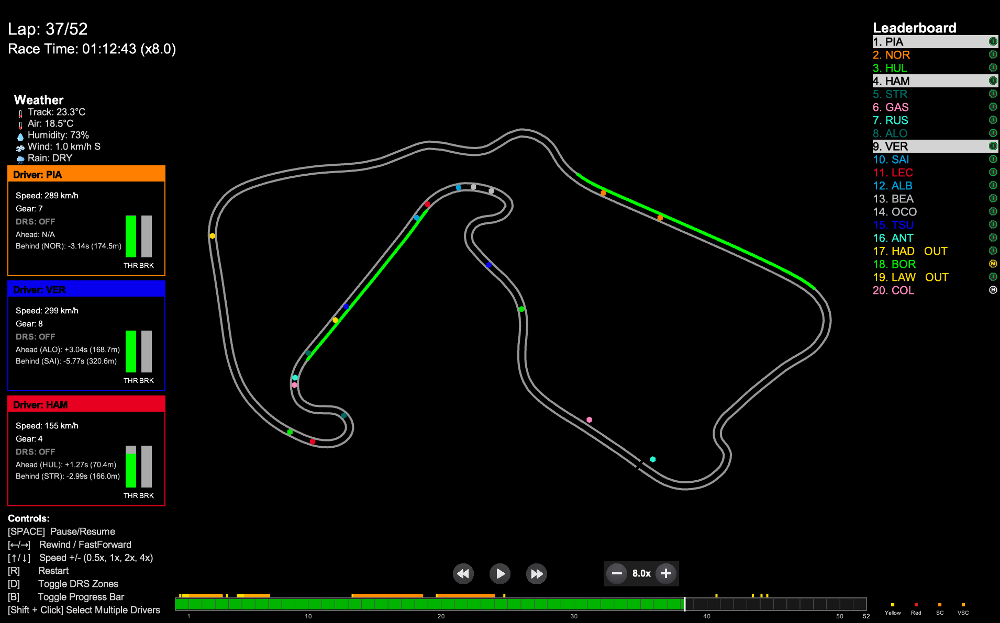
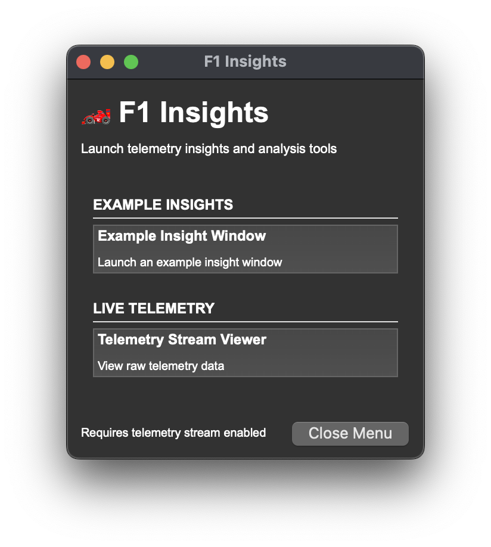
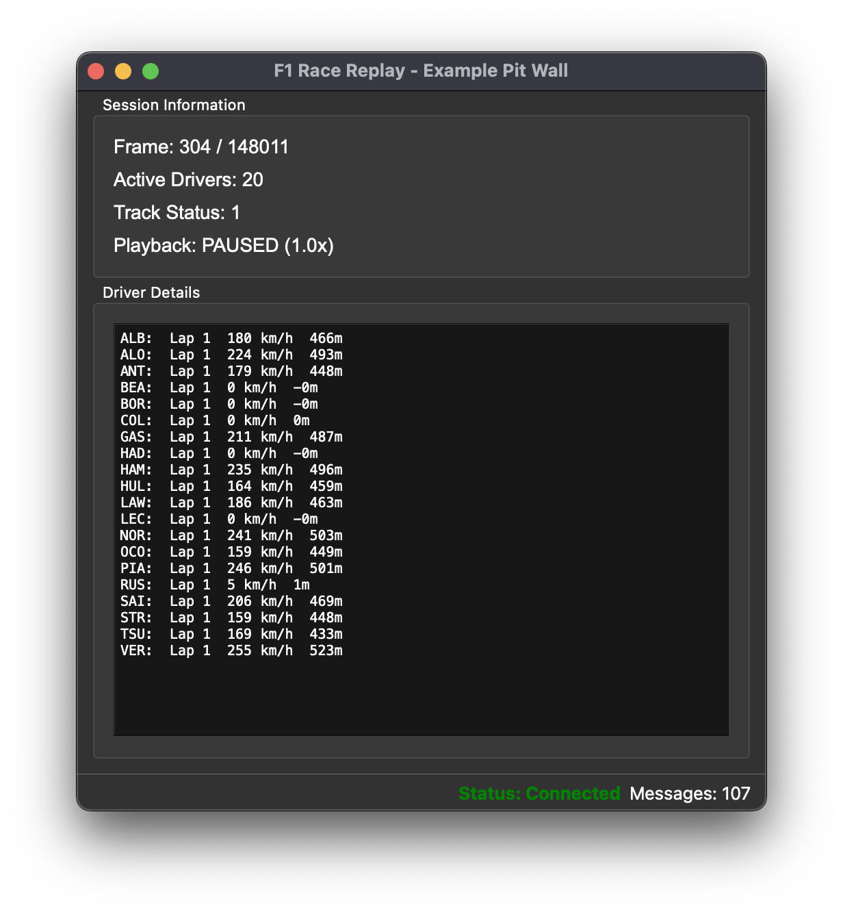
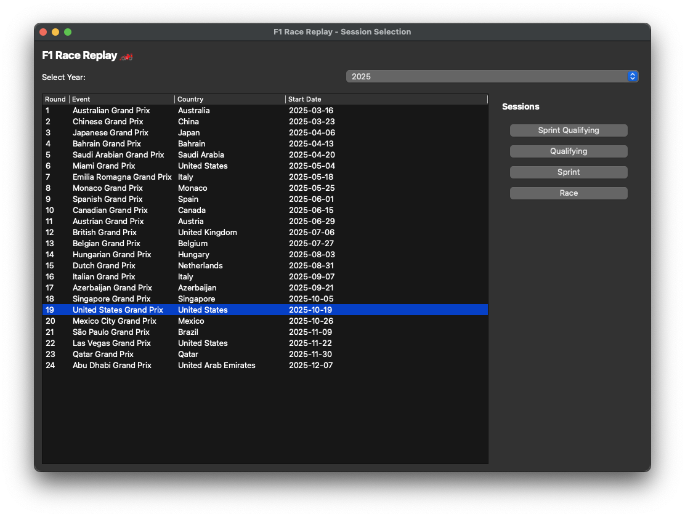
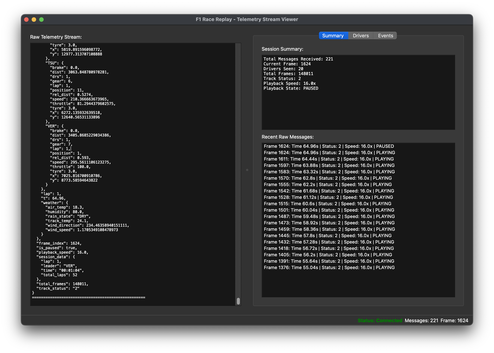

# F1 Race Replay Data Control Center

<p align="center">
  
  
  
  
</p>

<p align="center">
  
</p>

A premium Formula 1 telemetry and race intelligence platform built for live timing, lap analysis, strategy review, and replay workflows. This project combines a data-rich Streamlit control center with a desktop-grade racing interface, giving you a complete operational picture of sessions, drivers, tyres, and performance trends.

## Why this project stands out

- Real-time and historical race data workflows for F1 analysis
- High-contrast, race-control inspired dashboard UX
- Driver, constructor, circuit, and telemetry insights in one place
- Local SQLite storage with sync-ready dataset management
- Replay, strategy, and pit-wall style views for deeper racing analysis

## Dashboard preview

<p align="center">
  
</p>

## Key features

### Race intelligence dashboard
- Session overview cards and KPI summaries
- Live timing style status blocks
- Local dataset health and sync tracking
- Grid, lap, tyre, and performance summaries

### Telemetry and strategy analysis
- Circuit explorer and telemetry views
- Tyre-degradation strategy insights
- Driver comparison and historical race review
- Pit wall style operational analysis

### Data layer
- OpenF1 and Jolpica source integration
- SQLite repository with idempotent dataset tracking
- Cached local records for performance and continuity
- Export-friendly data handling for downstream analysis

## Screenshots

<div align="center">
  <table>
    <tr>
      <td width="50%">
        
      </td>
      <td width="50%">
        
      </td>
    </tr>
    <tr>
      <td width="50%">
        
      </td>
      <td width="50%">
        
      </td>
    </tr>
  </table>
</div>

## Analytics and graph views

The platform is designed to present race data in a way that feels like a Formula 1 operations room: charts, distribution views, tyre wear, timing deltas, and race strategy overlays are all surfaced in a performance-focused layout.

<p align="center">
  
</p>

## Quick start

### Web app
```powershell
py -m venv .venv
.\.venv\Scripts\Activate.ps1
pip install -r requirements.txt
streamlit run streamlit_app.py
```

### Desktop app
```powershell
pip install -r requirements-desktop.txt
python main.py
```

## Project architecture

```text
F1-Race-Replay-Data-Control-Center/
├── app/                  # shared data access and service layers
├── database/             # SQLite repository and persistence logic
├── services/             # provider and sync orchestration services
├── src/                  # replay, telemetry, GUI, and strategy modules
├── tests/                # project validation suite
├── resources/            # screenshots and product imagery
├── streamlit_app.py      # main dashboard entry point
├── main.py               # desktop app entry point
├── requirements.txt
├── requirements-desktop.txt
├── README.md
├── STREAMLIT_DEPLOYMENT.md
├── INSTALLATION.md
└── API_SETUP.md
```

## Data sources and reliability

This project is built around provider-backed F1 data, using OpenF1 and Jolpica sources when available. Where provider data is missing or a session is unavailable, the app gracefully surfaces the status instead of inventing data.

- Local SQLite persistence for cached and retrieved data
- Provider-aware dataset handling for sessions and race information
- Safe fallback messaging for unavailable or incomplete source data

## Deployment notes

See the project docs for environment configuration and deployment guidance:

- [STREAMLIT_DEPLOYMENT.md](STREAMLIT_DEPLOYMENT.md)
- [INSTALLATION.md](INSTALLATION.md)
- [API_SETUP.md](API_SETUP.md)
- [DATABASE_SCHEMA.md](DATABASE_SCHEMA.md)

## Built for the paddock, the pit lane, and the strategy room

This project is designed to feel like a modern racing control center: fast, technical, polished, and built around the signals that matter during a Grand Prix weekend.

<p align="center">
  
</p>

---

<p align="center">
  <strong>F1 Race Replay Data Control Center</strong><br />
  Race data, telemetry intelligence, and strategy clarity in one control-surface.
</p>


